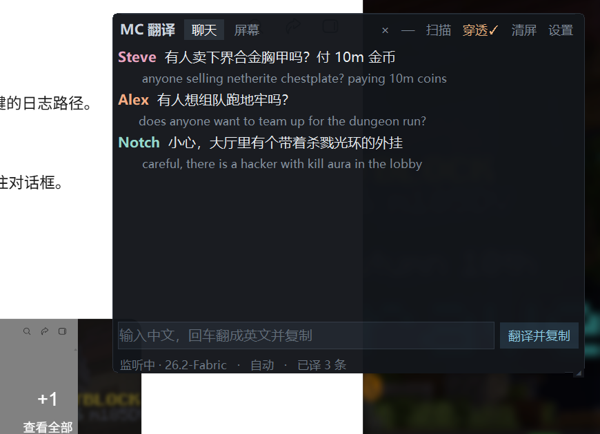

# MC 翻译 · Minecraft 国际服中文助手

> 在 Minecraft Java 版国际服里，把别人的英文聊天实时翻成中文，把侧边栏、物品名、任务提示也一起翻掉。
> 不装模组、不改游戏文件，只读游戏自己写的日志 + 系统自带 OCR。



## 它能干什么

**1. 聊天翻译** — 公屏里别人说的话，1 秒内翻成中文，显示在游戏右侧的小悬浮窗里。译文在上，灰色小字是英文原文。

```
Steve   有人卖下界合金胸甲吗？付 10m 金币
        anyone selling netherite chestplate? paying 10m coins
```

**2. 屏幕翻译** — 侧边栏目标、任务提示、悬停物品的 tooltip 这些不在聊天框里的英文，按 `F10` 截图识别后翻译。

**3. 反向回话** — 底部输入框打中文，回车翻成英文并复制到剪贴板，切回游戏 `Ctrl+V` 就能发。

翻译前自动展开黑话（`gg wp` → good game well played），翻完再纠正成国服译名（`netherite` → 下界合金、`elytra` → 鞘翅、`creeper` → 苦力怕、`kill aura` → 杀戮光环）。

## 环境要求

- Windows 10 / 11
- Python **3.10+**，安装时勾选 `tcl/tk and IDLE`
- **只支持 Java 版**。基岩版（手机 / Win10 商店版）不把聊天写进日志，用不了

不需要 `pip install` 任何东西——只用 Python 标准库（tkinter / urllib），OCR 用 Windows 自带组件。

## 快速开始

1. 下载本仓库（`Code` → `Download ZIP`，或 `git clone`）
2. 双击 **`启动翻译器.bat`**
3. 窗口出现在屏幕右侧，状态栏显示 `监听中 · 版本名` 就说明连上了游戏日志
4. 进服务器，等别人说话

> 用 PCL / HMCL、开了版本隔离都没关系，程序会自己找到 `versions/版本名/logs/latest.log`；
> 游戏正在运行时还会直接读游戏进程的启动参数，最准。

## 快捷键

全局生效，游戏里按也管用：

| 按键 | 作用 |
|---|---|
| `F6` | 打开设置 |
| `F7` | 鼠标穿透（点窗口不挡游戏操作，再按恢复） |
| `F8` | 显示 / 隐藏窗口 |
| `F9` | 清屏 |
| `F10` | 截取整个游戏窗口，识别并翻译 |
| `F11` | 只识别鼠标附近的文字（悬停物品时用，又快又准） |

窗口可拖标题栏移动、拖右下角 `◢` 改大小，位置会记住并跟着游戏窗口走。

## 翻译通道

设置里默认 **自动**，按顺序尝试：

1. **火山翻译（豆包）** — 免费、快
2. **MyMemory** / **有道** — 备用
3. **本地词库** — 断网也能翻常见游戏术语

想更准可以填自己的大模型 API（设置 → 大模型 API），支持任何 OpenAI 兼容接口：DeepSeek、通义、智谱、硅基流动、Kimi、本地 Ollama 都行。填了 key 自动优先走大模型。

翻译结果本地缓存，同一句话只翻一次；`gg`、`ty` 这类常用语直接命中内置词典，不联网。

## 常见问题

**状态栏一直显示「正在查找游戏日志」**
游戏还没启动过就先开一次游戏；启动器装在别的盘，进设置点「自动检测」；还不行就手动粘贴日志路径，形如 `D:\...\.minecraft\versions\版本名\logs\latest.log`。

**悬浮窗挡住画面**
拖走，或按 `F7` 开鼠标穿透。独占全屏（Fullscreen）会盖住所有窗口，请用窗口化或无边框全屏。

**屏幕翻译认错字**
设置里把「识别清晰度」调到 3，或用 `F11` 只扫鼠标附近。像素字体偶尔会认错（`SKYBLOCK` 认成 `5K BLOCK`），不影响大意。

**有消息但翻不出来**
双击 `检查翻译通道.bat`，它会逐个测试接口，告诉你哪个能用。

更多细节见 [使用说明.md](使用说明.md)。

## 目录结构

| 文件 | 说明 |
|---|---|
| `mc_translate.py` | 主程序，单文件，无第三方依赖 |
| `启动翻译器.bat` | 启动 |
| `检查翻译通道.bat` | 诊断翻译接口和日志路径 |
| `使用说明.md` | 完整使用手册 |
| `config.json` | 设置（首次运行自动生成，**不入库**） |
| `cache.json` | 翻译缓存（自动生成） |
| `聊天记录.log` | 中英对照聊天记录（自动生成） |

## 说明与限制

- 聊天翻译靠**读日志**，只覆盖聊天框里的内容；物品栏、侧边栏靠 OCR 截图
- 走公开免费接口，量大可能限流，程序会自动换通道 + 缓存
- 仅供学习交流，请遵守各服务器规则

## 许可证

[MIT](LICENSE) © 2026 panzhihuiqq
